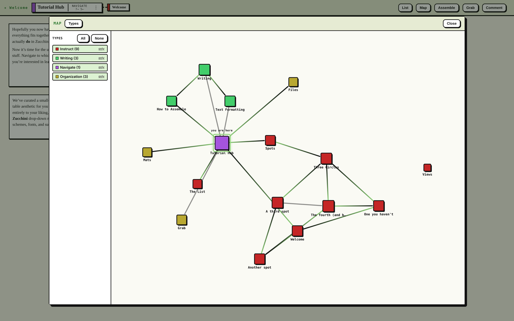

It's not only an edible domesticated squash. It's also a workbench for putting your ideas together. Inspired by the classic Mac application HyperCard (gone but not forgotten), Zucchini helps you lay out and connect your thoughts alongside the actual files on your Mac, from scripts and spreadsheets to text documents, images, or a dissertation’s worth of PDFs.

It's a desk where you can throw a messy pile of mixed-type files and ideas and turn them into the shape you discover they should be. Pin a data table right next to the research question it answers, under a PDF of the methodology that produced it. Drop characters inside of locations, and locations inside of plot points. Build a project as an interconnected network of rooms and surfaces, walk around inside your work, and assemble your finished writing from the pieces you’ve gathered.

If you're writing a novel, Microsoft Word or Google Docs are powerful tools. If you're analyzing data, RStudio could be your best bet. Zucchini is for the messy stage before that, when your project is still a tangle of PDFs, spreadsheets, images, notes, and questions that need a shared room to make sense of, and an assembly table to turn them into finished work.

{{mat: Spots and Doors}}

{{box}}

Zucchini is organized into spots, each of which is a blank canvas on which you can drop, move, or arrange things. This includes images, files, and text boxes. Put whatever you want wherever. A spot grows as you fill it. You can also add a door, i.e., a link, from one spot to another. A Zucchini project contains a network of spots, created by your choices as to which ideas are connected and which things belong together. Click a door from one spot to another, and you move there.

{{/box}}

{{/mat}}

{{mat: Text and Assemble}}

{{box}}

Want to write some text? Do it! I won't stop you. Each text box can take all the text you want. Text boxes also support basic markdown, so go crazy with that bold and italic flair. A full project might have lots of spots with lots of text boxes. Assemble is a way to gather that writing from anywhere into one ordered list, and then write it out as a single file. Navigate your network of spots, picking up the text boxes you want and adding them to the assembly table.

{{/box}}

{{/mat}}

{{mat: List and Map}}

{{box}}

Get messy! Your work is always findable. The map gives you an overview of your entire project, visualized as the network of spots you have linked with doors. Click a spot to go to it, or examine the shape of your project as a whole. Filter the map by spot type, or enjoy a look at the entire thing.

The list lets you search everything. See what's in the spot you're at, or all spots, or any selection of spots. Search for spots, text, or documents by name. Name mats and they'll show up on the list too!

{{/box}}

{{/mat}}

{{box}}

Each project is saved as a .zuke file, at a path you chose, on your disk. Open it, move it, rename it, back it up, put it in Dropbox, go nuts! Even without Zucchini, your work is never locked away. The .zuke file is indented, human-readable JSON. You can open it in a text editor. You can read it. You can grep it. There is no save button, and no unsaved state. What is on screen is what is on disk. Writes are absorbed into a window a few times a second, and each one goes to a temporary file which is then renamed over the target. Whatever you see on the screen in the second before a crash, a kernel panic, or an angry toddler descending on your laptop from on high is what you're going to see when you get things running again.

{{/box}}

{{mat: Documents}}

{{box}}

You can add files to any spot. Zucchini treats these as links to the originals, not as copies stored in your project. Add your collection of vintage .doc files, or a whole pile of spreadsheets. You never have to worry about duplicate files or accidental edits. Click on a file and it opens in its preferred app. Change its filename or location on your computer and Zucchini will follow it and update. Zucchini detects image files and renders them as resizeable images, rather than document links. Decorate your spots with pictures, or use spots to organize relevant diagrams or photos.

{{/box}}

{{/mat}}
