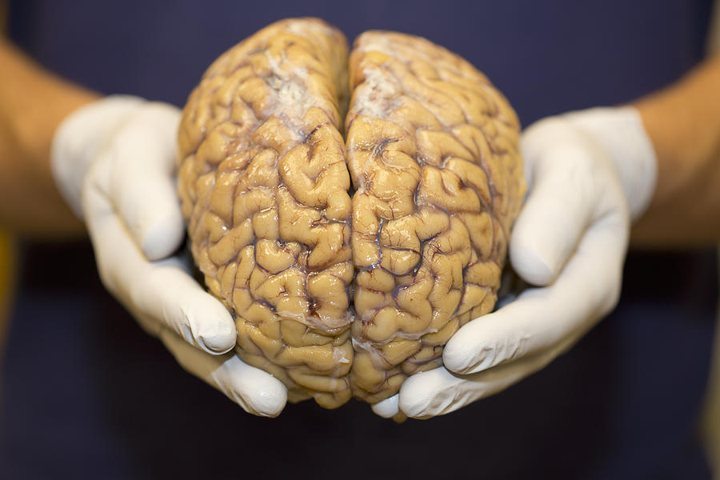
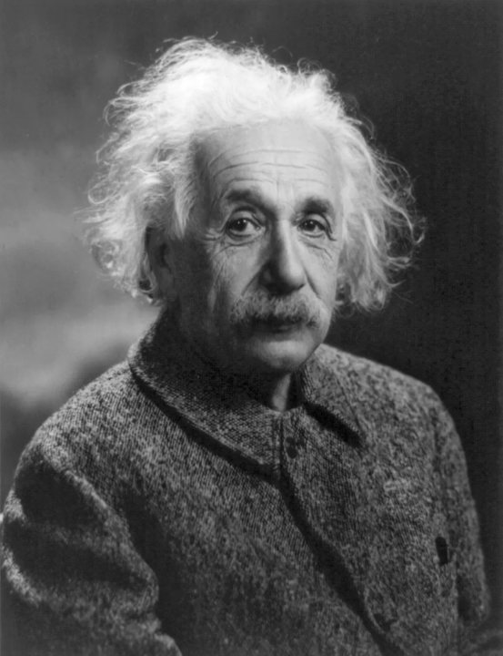

Bet you weren’t expecting to see me again

The human brain is a fascinating organ[^1]. Its many functions are diverse, complex, and interconnected. A functioning brain processes sensory information. It builds and stores memories. It makes decisions both big and small. And it does all these things (and more) at the same time. But how did it come to exist in the first place?

There’s a lot we don’t know about the origins of the modern human brain. But we do know that it is the result of millions of years of evolutionary history, molded by the constant struggle of our ancestors to survive and to reproduce. Because of this history, the brain is extremely good at dealing with many of the situations that we humans are (or were) likely to encounter.

This is why most of us remember many names and faces and the complex social relationships between them. We are perhaps the most social of all the primates, so this skill is central to the human way of life. It’s also why we are able to recall important events in the past and use those memories to inform our future decisions. Learning from our mistakes and our successes has been crucial to our survival.

And it’s why we all have an intuitive grasp of physics.

Think about it. If someone tosses a ball your way, you can probably catch it. Your brain has calculated the ball’s path through space, even if you would find it difficult to sit down and calculate the ball’s parabolic trajectory mathematically. In fact, your brain can model all sorts of physical interactions. You can imagine what might happen if you drove your heavy truck over a rickety wooden bridge. You can assess whether a river is moving so quickly that you would be swept away if you tried to swim across. You can judge whether it’s too far for you to jump from one tree branch to another.

We have an intuitive grasp of physics because understanding the world in this way helped our forebears to survive. We might like to think that our brains are good at perceiving and interpreting reality. But that’s not what our brains do. They perceive and respond to an extremely narrow range of physical parameters - only those that are relevant to staying alive and making babies[^2].

A great deal of the universe, however, lies beyond these parameters. There’s no reason to expect that our intuition will be a good guide to what is happening there. In fact, when we move beyond the universe we can directly experience, we find that reality behaves in ways that are unexpected - wonderfully, spectacularly, mystifyingly unexpected. Over the next three lectures, we explore three axes of the extreme:

1. ***What happens at extremely high speeds?***

2. ***What happens when things are extremely massive?***

3. ***What happens when things are extremely small?***

Each of these explorations will take us to realms far beyond our innate understanding. And each corresponds to one of three foundational theories of modern physics: **special relativity**, **general relativity**, and **quantum mechanics**. In this first lecture, we will explore what happens at extremely high speeds with an introduction to Einstein’s special theory of relativity.

## THE NATURE OF SPEED

Our poor monkey[^3] brains evolved during the ancient monkey times to deal with monkey problems. They are not very happy to see the world as we are about to see it. It’s worth remembering that the concepts we’re dealing with today are not actually that complicated. It’s our brains that make them complicated. So, first we have to unlearn our most basic understanding of how things are. After that, the rest is easy. Let’s give it a try!

We have an intuitive sense for speed. We know that airplanes are faster than cars, and cars are faster than snails. But often having an intuitive sense means we don’t bother to generate a more formal definition. When we say that a car is faster than a snail, what do we actually mean by that? Here (in excruciating detail) is what we mean:

Imagine a car drives past you at 60 miles per hour. If that car continues to travel at that speed for one hour, it will be 60 miles away from you. If you place a snail on the ground and it begins to flee from you (in terror) at 5 centimeters per minute, then every minute that passes will find it 5 centimeters farther away from you. That is how we understand speed, it is *a measure of distance displaced over a given amount of time.*

We can easily compare the speeds of two objects. If a car and a snail spend the same amount of time moving away from where you are, the car will be farther away from you than the snail is. So, the car is moving faster than the snail. No problem. This may not seem very exciting on its own. In fact, it really isn’t very exciting. In part this is because estimating the speeds of moving things is something our brains do all the time. This (as we will see) is going to get us into trouble.

<video src="recap/speed.mp4" autoplay loop muted playsinline></video>

Before we get into trouble, let’s cover a few other important things about speed. These are things that we should all be able to agree on, even if you never formally considered them before.

### 1. Speed is relative

A duck stands on the side of the highway. The duck is motionless - he is at peace with himself and the world. A bus drives past at 50 miles per hour. What is the duck thinking about? Who can say? He is a duck. Another bus drives past at 50 miles per hour.

We know that when we say the bus is moving at 50 miles per hour, we mean that in an hour it will be 50 miles away from where it was. But to make sense of “where it was”, we have to consider the bus’s location relative to something else. In this case, the bus is moving 50 miles per hour *relative to* the duck on the side of the road. In an hour, that bus will be 50 miles away from him. More broadly - we can also say that the bus is moving at 50 miles per hour relative to the road itself or, even more broadly, the surface of the earth.

<video src="recap/speed-is-relative.mp4" autoplay loop muted playsinline></video>

Another duck sits on a bus. He contemplates the mountains as they pass by. He is at rest, lost in his thoughts. The road is long, but the ride is smooth. If you were to ask this duck what speed the bus was moving at, he would say “quack”. But if he could talk, what would he say? In an hour, the bus will not be 50 miles away from him. He is traveling along with the bus. So, relative to him, the bus is not moving at 50 miles per hour. It is moving at 0 miles per hour.

You might be tempted to say, “well sure, but that’s just because the duck on the bus is *also* moving at 50 miles per hour, so the bus just *seems* to be standing still from his perspective.” This is your monkey brain talking. Our monkey brains have evolved over many millions of years to give priority to the **frame of reference** in which the surface of the earth is motionless. This makes sense - pretty much any time you are estimating the speed of something, the most useful thing to measure its speed relative to is the earth’s surface.

But this has more to say about us than about the nature of motion in the real universe. In the past minute, for example, the earth has moved more than 1,000 miles in its orbit around the sun. So, despite feeling confidently at rest, the duck on the side of the highway is roaring through space at an astounding speed of nearly 67,000 miles per hour. Since estimating their speed relative to the rest of the solar system was never a matter of life and death for our ancestors, this frame of reference doesn’t seem intuitive.

For the duck on the side of the highway, the bus is going 50 miles per hour. For the duck on the bus, the bus is going 0 miles per hour. For a duck standing on the surface of the sun, watching these proceedings through a telescope, the bus and the duck on the side of the road are both tearing through the sky at nearly 90 times the speed of sound. These are all equally correct, which leads us to the next important point.

### 2. All objects moving at a constant velocity can correctly claim to be at rest.

This is a big deal. There is no difference between an object that is moving at a constant velocity and an object that is “not moving”. Note that this doesn't mean that moving at a constant velocity is *like* not moving. It means that moving at a constant velocity and not moving *are the same thing*. This may seem counterintuitive, but it’s a principle that has been argued for a long time. Galileo proposed a thought experiment to illustrate this concept all the way back in 1632:

> *Shut yourself up with some friend in the main cabin below decks on some large ship, and have with you there some flies, butterflies, and other small flying animals. Have a large bowl of water with some fish in it; hang up a bottle that empties drop by drop into a wide vessel beneath it. With the ship standing still, observe carefully how the little animals fly with equal speed to all sides of the cabin. The fish swim indifferently in all directions; the drops fall into the vessel beneath; and, in throwing something to your friend, you need to throw it no more strongly in one direction than another… When you have observed all these things carefully, have the ship proceed with any speed you like, so long as the motion is uniform and not fluctuating this way and that. You will discover not the least change in all the effects named, nor could you tell from any of them whether the ship was moving or standing still.*[^4]

You might have experienced this for yourself. Have you ever woken up from a nap on an airplane and been confused as to whether you were still in the air or had already landed? If the window shades are closed and there is no turbulence, it’s hard to tell. And as Galileo suggests, there’s no experiment you could perform with things inside the airplane that could tell you whether you were motionless on the tarmac or speeding through the air at 500 miles per hour.

That’s because there’s *no difference* between those two states - they are equivalent. In other words, the duck by the side of the road is at rest and the buses are passing by it at 50 miles per hour. The duck on the bus is also at rest, and the highway, the mountains, and the whole Earth outside are passing by it at 50 miles per hour. These two viewpoints - these *frames of reference* are both equally correct. Your monkey brain may protest, but with a little effort you can tell it to be quiet.

### 3. Speed is additive and subtractive

<video src="recap/apple-cannon.mp4" autoplay loop muted playsinline></video>

This duck is riding a modified bus. It has a cannon on its roof that shoots apples. The apples fly out of the cannon at a speed of 20 miles per hour relative to the bus. Why has the bus been modified in this way? Nobody knows. The duck is not responsible. If this duck were to look out of the front window, it would see apples moving away from it at a speed of 20 miles per hour. It would also see the duck on the side of the road approaching it at 50 miles per hour and then receding into the distance at 50 miles per hour.

<video src="recap/apple-from-the-road.mp4" autoplay loop muted playsinline></video>

The modified bus rolls past the duck on the side of the road. This duck also sees the apple shoot from the front of the bus. But it’s not going 20 miles per hour. It’s going much faster - 70 miles per hour. This is because speeds are additive. The apple is flying forward at 20 miles per hour relative to the bus. But the bus is moving 50 miles per hour relative to the road. These speeds add together.

If you’ve ever been on an airplane you have experienced this firsthand. Imagine that you get up while the plane is cruising and make your way up the aisle to your friend at the front of the cabin. The plane is moving at about 550 miles per hour relative to the ground. And you are walking through the plane at about 3 miles per hour. So you are moving at a sprightly 553 miles per hour relative to the ground. When you finish chatting with your friend and turn around to go back to your seat, you are now moving 3 miles per hour in the opposite direction. Your speed across the ground has slowed to a miserable 547 miles per hour.

Your monkey brain knows all about this. It’s the reason why running away from things that are chasing you works (at least some of the time). Here’s the problem, though: it’s not necessarily how the universe works. To get a sense for how these principles break down at extremely high speeds, let’s look at something that moves very fast indeed.

## THE CURIOUS CASE OF LIGHT

Light is fast. Super fast. Almost unbelievably fast. We have never experienced the world at the speed of light or even anywhere near it. The fastest humans ever (relative, again, to the surface of the earth) were the Apollo 10 astronauts. On their return journey from lunar orbit, they raced through the heavens at nearly 25,000 miles per hour. This is insanely fast. But light travels almost thirty thousand times faster than that.

The exact speed of light is something many scientists have worked to calculate, both experimentally and through theory and mathematics. We now know this speed to a great degree of precision - it is just a little bit less than 671 million miles per hour, or 300 million meters per second. Now you should be asking yourself, “*671 million miles per hour relative to what?*” This is a great question. But let’s leave that to one side for a moment.

We have known that light is a kind of wave since the early 1800’s. Thomas Young, a British scientist, first discovered that passing a beam of light through a pair of thin slits creates an interference pattern in the light falling on the wall behind. This pattern was very similar to what he saw when he watched ripples in water moving through a thin slit. This discovery provided physicists with their first (and ultimately incorrect) answer to the question of “*671 million miles per hour relative to what?*”

Scientists in the mid to late 1800’s knew that waves are propagating disturbances carried through some medium. The ripples from a stone tossed into a pond are carried by the water. The sounds of a conversation are carried across the room through the air. Without a medium, waves cannot propagate. This is why there is no sound in the vacuum of space (a good thing by the way; if sound could travel through space, the roar of the sun would be as loud as a rock concert).

It would be very interesting, then, to know what medium is responsible for carrying the light wave. Whatever this substance was, it would have to be colorless and odorless, since it had never been observed. It would have to be unaffected by most known physical forces, since there seemed to be no way to measure its presence. And it would have to permeate the entire visible universe, since the light of distant stars still reached the Earth. When measuring the speed of light, scientists figured, its calculated speed of 300 million meters per second must be relative to the medium it is traveling through.

Despite having no direct evidence for this medium, physicists gave it a name - the **luminiferous ether**. And they set about looking for it[^5]. But experiment after experiment failed to detect the presence of the ether. If the earth were orbiting through an ocean of ether, there would have to be an “ether flow”, a current of ether in some direction. Light pulled along by the flow, like a canoe in a fast river, should travel at a different speed than light moving perpendicular to the flow. But time and again, the speed of light worked out to be exactly the same no matter where, or in what direction, it was measured. To cut a long and very interesting story short, this is extremely weird.

Let’s add one more weird fact about light to the list. Another British scientist and mathematician, James Clerk Maxwell, proposed that light was not only a kind of wave, it was in fact a kind of **electromagnetic wave**. Maxwell’s innovative equations unified theories of magnetism, electric currents, and charges. These equations also seemed to be able to predict the dynamics of light. And most intriguingly, while Maxwell was able to use these equations alone to derive the speed of light, these equations did not specify what that speed was in relation to. There was no benchmark against which the speed was defined.

### Turning Observation into Axiom

It was puzzling that experiments didn’t show any evidence for the existence of the ether. It was maddening that the speed of light appeared to be the same, no matter how the measuring equipment was moving or in what direction it was pointing. It was intriguing that the equations defining electromagnetism produced a speed for light but did not give a point of reference against which that speed was measured.

It was Albert Einstein - the reason why we will forever connect scientific genius with bad hair days - who took the risky intellectual leap that untangled this confusing set of contradictions. Here is the leap, and it is a big one: if the math is giving a speed for light, but the math is not specifying a benchmark, and if the experiments can't find any evidence for the ether, and if every measurement of the speed of light gives the same answer no matter what, then maybe the **speed of light is a constant.**

He was so much younger than this when he came up with special relativity

This is a profound conclusion. Einstein didn’t mean that light never accelerates or changes speed. He meant that the speed of light is always 300,000,000[^6] meters per second. It doesn’t matter how fast you are going, or which direction the light is moving.

The speed of light is ALWAYS ALWAYS ALWAYS 300,000,000 meters per second.

“Relative to what?” you should be asking. And Einstein says, “relative to whoever cares to measure it.” If this is true, it’s going to take us into some strange realities pretty quickly. Let’s take a look at how.

Night falls on the highway and the bus turns on its headlights. If the duck on the bus could measure it, he would say that the light pouring out of the headlights was moving away from him at 671,000,000 miles per hour (i.e., 300,000,000 meters per second).

The duck on the side of the road also watches the headlights. Does he see the light moving at 671,000,0**50** miles per hour? The light is being shot out of the front of a moving bus after all. If it were an apple, the two speeds would be added together. But - and this is critical - if Einstein’s axiom is right, both ducks will report the light as moving exactly the same speed relative to themselves. This will be true no matter how fast the two ducks were moving relative to each other.

The bus could be sizzling down the highway at 99% the speed of light (relative to the highway, of course). Still, the duck on the bus would say the light was moving away from him at 671,000,000 miles per hour. And the duck on the side of the highway would say the light was moving away from him at exactly the same speed. This idea is completely counter to our everyday experience. This is not something our monkey brains are going to like.

Imagine a cheetah is chasing you at 60 miles per hour. Your instinct would be to run away, right? Better yet, hop into a car and take off down the road. You hit 60 on the highway and risk a look behind you. The cheetah is still closing the distance between you at 60 miles per hour! That doesn’t make sense! Our intuition says that if you run away from something, its speed relative to you should go down. But according to Einstein, when it comes to light, that intuition is wrong. With light, there is no speed you could “run away” at that would have any effect on how quickly the light closed the distance between you[^7].

It’s worth pausing to note that incredibly accurate experiments carried out over the past century have borne this out. The speed of light is indeed 671 million miles per hour or 300 million meters per second relative to anything. This has some extremely uncomfortable implications for the nature of the universe. Let’s take a look at those now.

## THE NATURE OF TIME

What do we all know about time? We know that if you properly calibrate two clocks they will tick at the same rate. We know that two synchronized clocks will strike the hour at the same time. And we know that everyone will always agree on how long it takes for something to happen.

Here’s the problem: ***none of those are true***. They are all wrong. People and objects that are moving relative to one another will not agree that properly set clocks are ticking at the same rate. They will not agree on which things happen at the same time and which don’t. And they will not agree on the duration of any event. This is a result of the constancy of the speed of light in any frame of reference. It’s something that our monkey brains did not evolve to comprehend. We’ve never had to deal with objects moving quickly enough for any of these effects to be noticeable. But that doesn’t mean that they aren’t real. Give your monkey brain a moment to express its indignation. Then please ask it to take a seat while we look at some examples.

### The problem of simultaneity

<video src="recap/simultaneity-on-the-bus.mp4" autoplay loop muted playsinline></video>

Let’s make some modifications to our bus. Let’s hollow out the interior (our poor duck is left standing) and place a single lightbulb in the exact center. When turned on, this bulb will begin to send out light waves in all directions. The light turns on as the bus rolls down the road. The duck on the bus observes these beams of light (all of which are moving at the speed of light relative to him) as they spread. The front of the bus is exactly as far from the lightbulb as the back of the bus is. So, the beams of light hit both ends of the bus at exactly the same time. To the duck on the bus, those two events are *simultaneous*.

<video src="recap/simultaneity-from-the-road.mp4" autoplay loop muted playsinline></video>

The duck on the side of the road, however, would see things differently. He also observes the light turning on, and he will also see the light moving at the same speed in all directions. The beams of light are spreading outwards as if they were emitted from a lamppost on the side of the road. But, the bus is moving relative to him. The front of the bus is moving farther away from the point in space where he saw the light turn on. And the back of the bus is moving closer to it. So, the back of the bus rushes towards the beam of light and hits it first. And the front of the bus moves away from the light, which now has to travel a longer distance, and therefore hits second. To the duck on the side of the road, the two events are not simultaneous. Simultaneity is in the eye of the beholder.

Also, remember that any observer moving at a constant velocity can claim to be at rest. The duck on the bus is correct in believing that the bus is motionless and the earth is rolling by at 50 miles per hour. So, this confusing disagreement about simultaneity goes both ways. If the lightbulb was on the side of the road instead of the bus, our ducks would experience the exact same confusing contradiction in reverse. The duck on the side of the road would say that the light hit two equidistant points simultaneously. The duck on the bus would disagree.

If two observers disagree as to whether two events occurred at the same time or not, the only way to explain this is to accept the possibility that time itself is not the same everywhere. This is Einstein’s fundamental conclusion, derived from his investigation of simultaneity. The passage of time is variable, and it is changed based on motion.

### The nature of time itself

<video src="recap/light-clock.mp4" autoplay loop muted playsinline></video>

The effect of speed on simultaneity is fascinating - but it’s only one part of a much larger principle. Let's talk in a more concrete way about what the constant nature of the speed of light means for the passage of time. For this, we will need a clock. Any clock will work, and the effects we are about to discuss will be the same whether this clock is a stopwatch, or a grandfather clock, or a cell phone with a clock app. To illustrate the effect, however, we’re going to use a very special kind of clock that we’re going to call a “light clock”. The only reason we are using this clock is because its mechanism is extremely simple, allowing us to explore the effects of speed on time.

<video src="recap/light-clock-ticking.mp4" autoplay loop muted playsinline></video>

Here is how the light clock works. It is a jar with two mirrors, one on the top and one on the bottom. Inside the clock is a ball of light which bounces up and down off the bottom and top mirrors. Because the speed of light is a constant, every journey between the mirrors takes exactly the same amount of time[^8]. Every clock has a mechanism that performs this task. For the grandfather clock, the swinging pendulum “tick tocks” at a given rate. For a digital watch, the vibration of a quartz crystal supplies the “tick tock”. For the light clock, each bounce of the light ball up and down is a “tick tock”. The number of round-trip journeys (i.e., the number of “tick tocks”) is a measure of the amount of time elapsed.

<video src="recap/light-clock-on-the-bus.mp4" autoplay loop muted playsinline></video>

Now let’s put this clock on the bus. The duck on the bus observes the clock with curiosity. It is not peas (people like to feed ducks bread, but that’s actually quite bad for them. Peas are much better, if you have them), but the glow of the light interests him. From his perspective, the light clock is not moving. The ball bounces straight up and straight down.

The duck on the side of the road is also watching the light clock as the bus passes by. He is not hungry (he ate some oats earlier), but the light fascinates him as well. From his perspective, the light clock is moving to the right. When it bounces from the bottom mirror to the top mirror, the little ball of light is also moving from left to right.

This means that the distance between “tick” and “tock” is longer from the perspective of the duck on the side of the road than it is for the duck on the bus.

<video src="recap/two-clocks.mp4" autoplay loop muted playsinline></video>

Here’s the thing, though. Light moves at the same speed regardless of who is observing it. So if the distance between tick and tock is larger, but the speed of light remains the same, then the ball of light will take longer to go from “tick” to “tock” on the moving clock than on a stationary clock. To put it bluntly, from the perspective of the duck on the side of the road time is passing more slowly on the bus.

Again, remember that this goes both ways. Any observer moving at a constant velocity can claim to be at rest. If the duck by the side of the road also has a light clock, the duck on the bus would see that clock ticking more slowly than his own. So, from the perspective of the duck on the bus, time is passing more slowly on the side of the road.

Think about this. Each duck would say that the other duck’s time is passing more slowly. That is hard to imagine. But that is exactly the case. We call this effect **time dilation**. And remember that this is not just a clock phenomenon. The duck on the side of the road sees the duck on the bus moving more slowly too. The bus duck’s quack will be slower and longer, its waddle around the bus will be in slow motion. And when the bus duck looks out the window, he will see the exact same thing. The duck on the side of the road will be moving slowly, quacking slowly, living life slowly.

How slowly? If the path from tick to tock is twice as long on the moving clock, then each minute on the moving clock will take twice as long to elapse. Thus, the ratio of “tick to tock length” on the two clocks is the ratio of the passage of time on the two clocks. And this ratio is determined by the speed of the bus (or, more generally, the relative motion of the two clocks). The faster the speed, the longer the moving light ball’s path and the slower the tick tock of the moving clock. We can calculate this ratio, which we will call γ, using the equation below.

<math display="block"><mi>γ</mi><mo>=</mo><msqrt><mfrac><mn>1</mn><mrow><mn>1</mn><mo>−</mo><mfrac><msup><mi>v</mi><mn>2</mn></msup><msup><mi>c</mi><mn>2</mn></msup></mfrac></mrow></mfrac></msqrt></math>

And we can convert between clocks with this formula:

<math display="block"><mrow><mo>(</mo><mtext>time passed on the moving clock</mtext><mo>)</mo></mrow><mo>=</mo><mfrac><mrow><mo>(</mo><mtext>time passed on the stationary clock</mtext><mo>)</mo></mrow><mi>γ</mi></mfrac></math>

So, when one second of time has passed on the stationary clock, one second divided by gamma will have passed on the moving clock. Time passes more slowly on moving clocks.

### What about space?

Speed is space traversed over a given amount of time. But we have just learned that high speeds slow the passage of time. What does this mean for space?

Let’s imagine that the bus and the road are moving relative to each other at a speed close to the speed of light, let’s say 580,771,037 miles per hour. That works out to about 86.6% the speed of light - which (if you plug it into the equation above) gives us a gamma of 2. When the duck on the side of the road sees a minute has passed on his clock, he will see that only a half minute has passed on the clock on the bus (the opposite is also true, with Bus Duck seeing Road Duck’s clock ticking slowly).

But if Road Duck sees only half as much time pass on Bus Duck’s clock as on his own, how could the ducks agree on their relative speed? There’s only one explanation that makes sense. The two ducks must be measuring distance differently.

Here’s how this works: if the stationary clock ticks twice as quickly as the moving clock, then the moving object must travel twice as far in the stationary observer’s frame of reference as in its own. For our bus traveling down the highway at ludicrous speeds, this means that in the time it moves, say, five bus lengths as measured on the moving clock, it must move ten bus lengths from the perspective of the stationary clock.

So, however long the duck on the bus would measure the bus as being, the duck on the side of the road would say the bus is half as long. If Bus Duck measures the bus at 100 feet long, Road Duck would say it is only 50 feet long. The bus would appear squished - length contracted - in the direction of motion. Bear in mind that the length contraction (i.e., the squishing) only occurs in the direction of movement. This is because that is the only direction where any discrepancy between clocks exists.

Length contraction is a direct counterpart to time dilation. If the moving clock ticks three times more slowly, the stationary observer will witness the moving object as being three times shorter. Because of this, we can also calculate length contraction using γ and the following formula, which is the counterpart of the formula for calculating time dilation.

<math display="block"><mrow><mo>(</mo><mtext>Length of moving object</mtext><mo>)</mo></mrow><mo>=</mo><mfrac><mrow><mo>(</mo><mtext>length of stationary object</mtext><mo>)</mo></mrow><mi>γ</mi></mfrac></math>

## THE PUZZLE OF MASS

We’re going to take a very brief moment to consider one final thing. Relative motion affects the passage of time. It affects the measurement of length and distance. It affects the perception of simultaneity. Einstein’s first paper on relativity delves into these effects, but there is one formula that you won’t find in it:

<math display="block"><mi>E</mi><mo>=</mo><mi>m</mi><msup><mi>c</mi><mn>2</mn></msup></math>

Oh come on, you didn’t think we were going to do Einstein’s theory of relativity and not dedicate any time at all to the world’s most famous equation, did you? It’s true that you can’t find it in the first relativity paper, though some of the groundwork for what it implies is laid down in that paper. Einstein was interested in many things beyond just simultaneity and time dilation. He was curious (for example) about inertia, and how changing speeds affects the energetics of moving objects. And his mathematical explorations led him to a startling conclusion: mass and energy are not separate phenomena. In fact, one can be converted into the other.

In this equation, *E* is an object’s energy (in joules), *m* is its mass (in kilograms, not grams, don’t forget that!) and *c* is the speed of light (in meters per second). As you can see if you examine the equation itself, the amount of energy in even a minuscule amount of mass is enormous. The speed of light, c, is a big number. The speed of light squared? Gigantic. But this equation is not entirely complete. We can write a slightly longer version of it, as follows:

<math display="block"><mi>E</mi><mo>=</mo><mi>γ</mi><msub><mi>m</mi><mn>0</mn></msub><msup><mi>c</mi><mn>2</mn></msup></math>

Yes, you cannot escape gamma. But let’s take a look at this equation for a second. First, notice that we’ve replaced *m* with *m*0, which is the object’s **rest mass**, that is, its mass when measured in its own inertial frame of reference.

What does this mean? Well, it means that the mass of an object is related to how fast it is moving (relative to a stationary observer, as always). We can call γ*m*0 **relativistic mass**. As an object’s speed increases, there’s time dilation, length contraction, and relativistic mass increase. All three of these go up by a factor of gamma. We will be focusing more on time and length than on mass (for reasons that we will get into later), but it’s good to have at least peeked at this formula before putting this week’s lecture aside.

You can also see, in this equation, one reason why no massive object can be accelerated to the speed of light. Remember, acceleration requires a force, and the greater an object’s mass, the greater the force required to accelerate it. As an object’s speed increases, its relativistic mass goes up by a factor of gamma. And remember, as an object’s speed approaches the speed of light, gamma approaches infinity. So, relativistic mass approaches infinity. And this in turn means that the force required to accelerate that mass also approaches infinity.

## ONE IMPORTANT PROBLEM

All of these insights are fascinating, and careful experimentation has borne them out in the years since Einstein first developed them. But, there is one major drawback to the special theory of relativity. It’s one that Einstein recognized immediately, and which he dedicated the next decade to solving. The special theory of relativity only works when all the objects in question are in **inertial frames of reference**. That is, not speeding up, slowing down, or changing direction. All potential observers must be able to validly claim to be at rest. And there must also be a frame of reference in which the objects they are observing are validly described as at rest.

But most interesting things in the universe are not at rest. Planets spin, cars speed up and slow down, asteroids are pulled[^9] this way and that by gravitational forces. How, then, do we take the special case in which relativity holds true and generalize it to all objects? How do we understand the effects of acceleration? As it happens, this question is much harder to answer. It requires more difficult mathematics, more complicated explanations, and, unexpectedly, a whole new view of what gravity and space really are. But we’ll leave that until next week.

## GLOSSARY OF TERMS

**Electromagnetic Wave**

A changing electric and magnetic field which propagates through space. These waves are not carried on a medium in the same way as mechanical waves (e.g., sound, water waves) are.

**Frame of Reference**

This has a fairly complicated physics definition. For our purposes, it is a coordinate system in which physical measurements are made. We will be concerned most with the **inertial frames of reference**, which is the frame of reference in which an observer can claim to be at rest. This is any coordinate system in which the objects in the system are not accelerating, changing direction, or spinning.

**Length Contraction**

An effect at high speeds in which a moving object’s length (from the perspective of a stationary observer) is reduced by a factor of 𝛾.

**Luminiferous Ether**

The proposed light wave-carrying medium. No experiments provided definitive evidence that the ether existed and our modern understanding of the universe is that it does not exist.

**Relativistic Mass**

The mass of a moving object as measured by a stationary observer. This may differ from the object’s rest mass by a factor of 𝛾.

**Rest Mass**

The mass of an object as measured in its own inertial frame of reference.

**Speed of Light**

Roughly 3 × 108 meters per second. This speed is the same when measured in any inertial frame of reference.

**Time Dilation**

An effect at high speeds in which the passage of time on a moving clock (from the perspective of a stationary observer) is slowed by a factor of 𝛾.

## IMPORTANT EQUATIONS

**Calculation of** 𝛾, **where** c **is the speed of light (in meters per second), and** v **is the velocity of the moving object (in meters per second):**

<math display="block"><mi>γ</mi><mo>=</mo><msqrt><mfrac><mn>1</mn><mrow><mn>1</mn><mo>−</mo><mfrac><msup><mi>v</mi><mn>2</mn></msup><msup><mi>c</mi><mn>2</mn></msup></mfrac></mrow></mfrac></msqrt></math>

**Calculation of time dilation from the perspective of the stationary clock:**

<math display="block"><mrow><mo>(</mo><mtext>time passed on the moving clock</mtext><mo>)</mo></mrow><mo>=</mo><mfrac><mrow><mo>(</mo><mtext>time passed on the stationary clock</mtext><mo>)</mo></mrow><mi>γ</mi></mfrac></math>

**Calculation of length contraction from the perspective of the stationary clock:**

<math display="block"><mrow><mo>(</mo><mtext>Length of moving object</mtext><mo>)</mo></mrow><mo>=</mo><mfrac><mrow><mo>(</mo><mtext>length of stationary object</mtext><mo>)</mo></mrow><mi>γ</mi></mfrac></math>

**Calculation of energy or mass as a function of speed, where** E **is energy (in joules),** c **is the speed of light (in meters per second), and** 𝛾 **is, well,** 𝛾.

<math display="block"><mi>E</mi><mo>=</mo><mi>γ</mi><msub><mi>m</mi><mn>0</mn></msub><msup><mi>c</mi><mn>2</mn></msup></math>

[^1]: Yes, this is the physics recap (I promise).

[^2]: As famed sensory physiologist Friedrich Barth says: “Sensory systems are not meant to provide organisms with a complete picture of physical reality… Keeping data out of the nervous system is as important a function of sensory systems as providing the relevant information.”

[^3]: You may protest “but humans didn’t evolve from monkeys!”, and this is strictly true. Humans are cousins, not descendants, of modern monkeys. To that I would say, okay, if you want to get into a phylogenetics fight, monkeys are a paraphyletic taxon unless you include apes. So, technically apes are a kind of (or subset of) monkey - and the common ancestor of humans and monkeys would also likely be called a monkey. It’s worth separating this from the “I didn’t evolve from a monkey” argument against the theory of evolution writ large. This argument is incorrect, not only because the arguer is usually referring to modern monkeys, but also because we actually did evolve from ancestral primates that were very much monkey-ish. A sharp reader may note that none of this is relevant or important to relativity.

[^4]: *Dialogue Concerning the Two Chief World Systems*, translated by Stillman Drake, University of California Press, 1953, pp. 186 - 187 (Second Day).

[^5]: This might sound crazy - inventing a phenomenon out of whole cloth and then looking around for physical evidence of it. But actually, a lot of important concepts in physics started out this way. “Theory first, experiments second” is a good way to describe the development of relativity theory itself, in fact. Provided your theory makes **falsifiable** claims, this is a valuable approach to doing science. Sometimes great theories make claims that aren’t falsifiable with current tools. This is one reason why the gap between theory and experimental evidence in physics is sometimes years or decades.

[^6]: Okay, the speed of light is actually 299,792,458 meters per second. That’s pretty dang close to 300,000,000 meters per second, so let’s round up to make calculations easier.

[^7]: From your perspective, that is. And this is going to be responsible for a lot of the interesting things we’re about to discover. Take a second to imagine a bemused onlooker watching as you run away from a beam of light. What would they see?

[^8]: Within a given frame of reference, that is.

[^9]: Or are they?? Check back next time for more on this.
